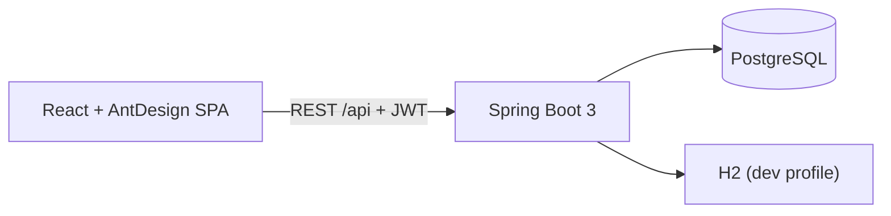

# ERP System 🏭

A full-stack **Enterprise Resource Planning** application covering **Inventory, Purchasing and Sales** workflows — built with **Java Spring Boot 3**, **React 18 (Ant Design)** and **PostgreSQL**.


## ✨ Features

| Module | Capabilities |
|---|---|
| 🔐 **Auth & RBAC** | JWT login/registration, BCrypt password hashing, 3 roles (`ADMIN` / `MANAGER` / `EMPLOYEE`) enforced on both API and UI |
| 📦 **Inventory** | Product catalog with SKU, categories, pricing, stock levels and reorder alerts |
| 🛒 **Purchasing** | Procure-to-pay flow: create purchase order → **Receive** (stock automatically increases) |
| 💰 **Sales** | Order-to-cash flow: create sales order → **Complete** (stock validated & deducted atomically) |
| 🏢 **Partners** | Supplier & customer master data |
| 👥 **User Management** | Admin-only: create users, change roles, delete |
| 📊 **Dashboard** | KPIs (revenue, spend, low-stock count, pending orders), low-stock alerts, recent activity |

**Business rules implemented on the backend:**
- Receiving a purchase order adds quantities to stock inside a single DB transaction
- Completing a sales order first validates availability of *every* line item, then deducts stock
- **Optimistic locking** (`@Version` on products): two simultaneous order completions cannot oversell — the loser gets a clean `409 Conflict` instead of corrupting inventory
- Draft-only order cancellation/deletion (audit-friendly: completed orders are immutable)
- Automatic order numbering (`PO-2026-00001`, `SO-2026-00001`)
- Low-stock detection: `quantityInStock <= reorderLevel`

**Production-grade engineering:**
- 🔁 **Refresh tokens** — 15-min access JWTs + 7-day revocable refresh tokens (stored as SHA-256 hashes), rotation on every refresh, reuse detection that revokes the whole session family, real server-side logout
- 🧪 **22 automated tests** — unit tests (Mockito) + full-stack integration tests (real HTTP, security, DB) + a Testcontainers test that runs the stack against real PostgreSQL 16
- 🗄️ **Flyway migrations** — hand-written, versioned schema (`V1__init_schema.sql`, `V2__add_refresh_tokens.sql`); Hibernate runs in `validate` mode
- 📖 **OpenAPI/Swagger** — live interactive docs at `/swagger-ui.html` with a JWT Authorize button

## 🏗 Architecture



```mermaid
erDiagram
    USER ||--o{ : ""
    SUPPLIER ||--o{ PRODUCT : supplies
    SUPPLIER ||--o{ PURCHASE_ORDER : receives
    CUSTOMER ||--o{ SALES_ORDER : places
    PURCHASE_ORDER ||--|{ PURCHASE_ORDER_ITEM : contains
    SALES_ORDER ||--|{ SALES_ORDER_ITEM : contains
    PRODUCT ||--o{ PURCHASE_ORDER_ITEM : ""
    PRODUCT ||--o{ SALES_ORDER_ITEM : ""
```

## 🚀 Quick Start (Docker — recommended)

```bash
git clone <your-repo-url> erp-system
cd erp-system
docker compose up --build
```

| Service | URL |
|---|---|
| Frontend | http://localhost:3000 |
| Backend API | http://localhost:8080/api |
| PostgreSQL | localhost:5432 (`erp` / `erp123`) |

### Demo accounts (seeded automatically)

| Role | Email | Password | Permissions |
|---|---|---|---|
| ADMIN | `admin@erp.com` | `admin123` | Everything + user management |
| MANAGER | `manager@erp.com` | `manager123` | Full CRUD on business data |
| EMPLOYEE | `employee@erp.com` | `employee123` | Read-only |

## 🛠 Manual Setup (without Docker)

**1. Database** — create a PostgreSQL database, then adjust `backend/src/main/resources/application.yml` (or set `DB_HOST`, `DB_NAME`, `DB_USER`, `DB_PASSWORD` env vars):

```sql
CREATE DATABASE erp_db;
```

**2. Backend** (Java 17 + Maven):

```bash
cd backend
mvn spring-boot:run
```

**3. Frontend** (Node 18+):

```bash
cd frontend
npm install
npm run dev     # http://localhost:5173, proxies /api → :8080
```

> 💡 No Postgres handy? Start the backend with the in-memory H2 profile:
> `mvn spring-boot:run -Dspring-boot.run.profiles=dev`

## 📡 API Reference (v1)

All endpoints are under `/api` and (except `/auth/**`) require a `Authorization: Bearer <token>` header.

| Method | Endpoint | Description | Min. role |
|---|---|---|---|
| POST | `/auth/login` | Login, returns access + refresh token | — |
| POST | `/auth/register` | Self-registration (EMPLOYEE) | — |
| POST | `/auth/refresh` | Exchange refresh token for a new pair (rotates) | — |
| POST | `/auth/logout` | Revoke the refresh token server-side | — |
| GET | `/auth/me` | Current user profile | EMPLOYEE |
| GET | `/products?q=&page=&size=` | Paged product search | EMPLOYEE |
| GET | `/products/low-stock` | Items at/below reorder level | EMPLOYEE |
| POST / PUT / DELETE | `/products/**` | Product CRUD | MANAGER |
| GET / POST / PUT / DELETE | `/suppliers/**`, `/customers/**` | Partner CRUD | GET: EMPLOYEE, rest: MANAGER |
| GET | `/purchase-orders`, `/purchase-orders/{id}` | List / detail | EMPLOYEE |
| POST | `/purchase-orders` | Create (DRAFT) | MANAGER |
| POST | `/purchase-orders/{id}/receive` | DRAFT → COMPLETED, stock ↑ | MANAGER |
| POST | `/purchase-orders/{id}/cancel` | DRAFT → CANCELLED | MANAGER |
| GET | `/sales-orders`, `/sales-orders/{id}` | List / detail | EMPLOYEE |
| POST | `/sales-orders` | Create (DRAFT) | MANAGER |
| POST | `/sales-orders/{id}/complete` | DRAFT → COMPLETED, stock ↓ (validated) | MANAGER |
| POST | `/sales-orders/{id}/cancel` | DRAFT → CANCELLED | MANAGER |
| GET / POST / PATCH / DELETE | `/users/**` | User management | ADMIN |
| GET | `/dashboard` | Aggregated KPIs | EMPLOYEE |
| GET | `/swagger-ui.html` | Interactive API docs (OpenAPI 3) | public |

> Interactive documentation: start the backend and open **http://localhost:8080/swagger-ui.html**

## 🧪 Running the tests

```bash
cd backend
mvn test
```

| Suite | What it covers |
|---|---|
| `*ServiceTest` (unit, Mockito) | Order lifecycle rules: stock deduction, insufficient-stock rejection, draft-only transitions, SKU uniqueness |
| `ErpApiIntegrationTest` (H2, real HTTP) | Login/registration, the full RBAC 403 matrix, order-to-cash & procure-to-pay end-to-end, oversell rejection, refresh-token rotation + theft detection + logout |
| `PostgresMigrationTest` (Testcontainers) | Full stack on **real PostgreSQL 16** — runs automatically wherever Docker is available (`disabledWithoutDocker`) |

## 📁 Project Structure

```
erp-system/
├── docker-compose.yml
├── backend/                     # Spring Boot 3 (Java 17)
│   └── src/main/java/com/erp/
│       ├── config/              # SecurityConfig, DataSeeder
│       ├── security/            # JWT service, auth filter, UserDetailsService
│       ├── entity/              # JPA entities (Product, Supplier, Customer, orders…)
│       ├── repository/          # Spring Data JPA repositories
│       ├── dto/                 # Request/response records
│       ├── service/             # Business logic (stock validation, order lifecycle)
│       ├── controller/          # REST controllers
│       └── exception/           # Global error handling
└── frontend/                    # React 18 + Vite + Ant Design 5
    └── src/
        ├── api/                 # Axios client + JWT interceptors
        ├── context/             # Auth context (login/roles)
        ├── components/          # Layout, reusable CRUD & order components
        └── pages/               # Login, Dashboard, Products, Orders, Users…
```

## 🎯 Engineering Highlights

- **Layered architecture** — controller → service → repository, with DTO records decoupled from JPA entities (no entity leakage to the API)
- **Spring Security done right** — stateless JWT filter chain, role-based URL rules, CORS config, BCrypt, plus a **refresh-token layer** (rotation, reuse detection, hashed storage) that makes logout and revocation real
- **Concurrency safety** — `@Version` optimistic locking turns the classic oversell race condition into a `409 Conflict` with zero lock contention
- **Transactional integrity** — stock mutations (receive/complete) run in a single `@Transactional` method with all-or-nothing validation
- **Global exception handling** — consistent JSON error contracts (`404` / `400` / `401` / `403` / `409`) via `@RestControllerAdvice`
- **Schema as code** — Flyway versioned migrations; Hibernate in `validate` mode (never mutates the schema)
- **Test pyramid** — unit (Mockito) + integration (real HTTP through the security filter chain) + Testcontainers production-parity checks
- **Optimized queries** — `JOIN FETCH` to avoid N+1 on order listings, JPQL aggregations for the dashboard
- **Zero-config demo** — a `CommandLineRunner` seeder creates demo users + sample data on first boot
- **Reusable React patterns** — shared `SimpleCrud` / `OrderPage` components, auth context with route guards, axios interceptors including **silent token refresh & retry**

## 🔮 Roadmap Ideas

- Payment & invoicing module, HR/payroll module
- Redis caching, CSV export, low-stock email alerts

---

Built as a portfolio project — feedback and PRs welcome!
